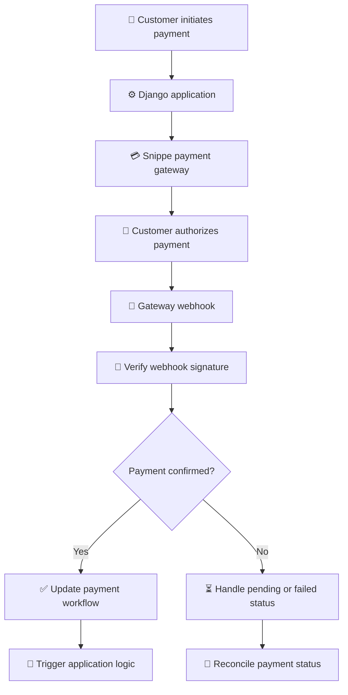

 <div align="center">

<!-- 🌌 ANIMATION 01: FUTURISTIC HEADER -->


<!-- ⚡ ANIMATION 02: TYPING EFFECT -->
<a href="https://snippe.sh">

</a>

<br/>

<!-- 🛡️ PROJECT BADGES -->
<a href="https://github.com/cleven12/django_snippe/actions/workflows/tests.yml"></a>
<a href="https://github.com/cleven12/django_snippe/actions/workflows/codeql.yml"></a>
<a href="https://pypi.org/project/django-snippe/"></a>
<a href="LICENSE"></a>

<br/>


<br/><br/>

**A clean, developer-friendly Django integration for the [Snippe](https://snippe.sh) payment gateway.**

Accept payments, manage payment records, handle payouts, verify webhooks, and connect payment events to your Django application with a straightforward Python API.

<br/>

<a href="#-features">Explore Features</a> •
<a href="#-installation">Installation</a> •
<a href="#-quick-start">Quick Start</a> •
<a href="docs/USAGE.md">Documentation</a> •
<a href="#-contributing">Contribute</a>

</div>

---

<!-- ✨ ANIMATION 03: SECTION DIVIDER -->

<div align="center">


</div>

## 🌍 Overview

**django-snippe** connects Django applications to the Snippe payment gateway, helping developers integrate digital payment workflows without building every integration component from scratch.

Designed for applications operating in Tanzania, Kenya, and Uganda, it supports payment-related workflows involving mobile money, cards, and QR payments, subject to the capabilities enabled by the gateway.

<table>
<tr>
<td width="50%" align="center">

### ⚡ Simplified Integration

Use Python helpers and Django-native components to connect your application to payment workflows.

</td>
<td width="50%" align="center">

### 🔐 Security-Conscious Design

Webhook signature verification, input validation, and audit logging help support safer payment processing.

</td>
</tr>
<tr>
<td width="50%" align="center">

### 📡 Event-Driven Workflows

React to payment and payout lifecycle events through Django signals.

</td>
<td width="50%" align="center">

### 🛠️ Django Admin

Manage payment and payout records through the Django administration interface.

</td>
</tr>
</table>

---

## 🚀 Features

<div align="center">

| Feature | Description |
|:---|:---|
| 💳 Payment Integration | Create payment requests through high-level Python helpers |
| 🏦 Mobile Money | Integrate mobile money payment workflows |
| 💎 Card Payments | Support gateway-enabled card payment workflows |
| 📱 QR Payments | Support QR payment workflows where available |
| 💸 Payouts | Manage payout records and lifecycle events |
| 🔐 Webhook Verification | Verify incoming webhook signatures |
| 📡 Django Signals | Respond to payment and payout events |
| 🛠️ Admin Dashboard | Filter, search, and inspect payment records |
| 🗃️ Database Models | Django models with migrations |
| ✅ Input Validation | Validate payment-related inputs |
| 🧾 Audit Logging | Maintain useful records for operational review |
| ⚙️ Python Helpers | Convenient `PaymentHelper` and `PayoutHelper` interfaces |

</div>

<div align="center">


</div>

---

## 🧰 Technology Stack

<div align="center">


<br/><br/>

| Technology | Purpose |
|:---|:---|
| 🐍 Python | Core programming language |
| 🎸 Django | Application framework |
| 🗄️ Django ORM | Payment and payout persistence |
| 🔔 Django Signals | Event-driven application integration |
| 🔐 Webhook Security | Incoming event verification |
| 🧪 Pytest | Automated testing |
| 🛡️ CodeQL | Static security analysis workflow |

</div>

---

## 📦 Installation

### Option 1 — Install from PyPI

```bash
pip install django-snippe
```

### Option 2 — Install directly from GitHub

```bash
pip install git+https://github.com/cleven12/django_snippe.git
```

### Option 3 — Download the source

**Linux / macOS**

```bash
curl -L https://github.com/cleven12/django_snippe/archive/refs/heads/main.tar.gz | tar xz
```

**Windows PowerShell**

```powershell
Invoke-WebRequest `
  -Uri "https://github.com/cleven12/django_snippe/archive/refs/heads/main.zip" `
  -OutFile django_snippe.zip

Expand-Archive django_snippe.zip
```

If installing manually, copy the `django_snippe/` package directory into your Django project alongside `manage.py`.

---

## ⚙️ Configuration

### 1. Register the application

Add `django_snippe` to `INSTALLED_APPS` in `settings.py`.

```python
INSTALLED_APPS = [
    # Existing Django applications...
    "django_snippe",
]
```

### 2. Configure your credentials

Set the required gateway credentials in your Django settings.

```python
SNIPPE_API_KEY = "snp_live_xxxx"
SNIPPE_WEBHOOK_SECRET = "your_webhook_secret"
```

**Security reminder:** For production, load credentials from environment variables or a secrets manager. Never commit real API keys or webhook secrets to source control.

### 3. Apply database migrations

```bash
python manage.py migrate
```

### 4. Register payment URLs

In your project's `urls.py`:

```python
from django.urls import include, path

urlpatterns = [
    # Existing application routes...
    path("payments/", include("django_snippe.urls")),
]
```

The integration exposes its webhook route under the configured prefix, including `/payments/webhook/` in this example.

---

## ⚡ Quick Start

### 💳 Create a mobile money payment

```python
from django_snippe.helpers import PaymentHelper

payment = PaymentHelper.create_mobile_payment(
    amount=5000,
    currency="TZS",
    phone_number="0712345678",
    customer_firstname="John",
    customer_lastname="Doe",
    webhook_url="https://yourdomain.com/payments/webhook/",
)
```

This example illustrates initiating a payment request. The actual payment outcome should be determined from verified gateway responses and the integration's supported lifecycle handling, not from the mere creation of the request.

### 📡 Listen for successful payments

```python
from django.dispatch import receiver
from django_snippe.signals import payment_completed


@receiver(payment_completed)
def on_payment_completed(sender, payment, **kwargs):
    print("Payment succeeded:", payment.reference)
```

Django signals let your application respond to payment events. For production workflows, make fulfillment idempotent, verify payment status, and prevent duplicate processing.

### 🔔 Payment workflow

<div align="center">



</div>

---

## 🔐 Security Best Practices

Security is a critical part of payment integration.

- 🔑 **Protect credentials:** Store API keys and webhook secrets outside source control.
- 🛡️ **Verify signatures:** Validate webhook signatures using the integration's supported verification mechanism.
- 🔁 **Prevent duplicate processing:** Design payment callbacks and fulfillment operations to be idempotent.
- 🧾 **Keep audit records:** Maintain appropriate records for payment events, errors, and reconciliation.
- 🌐 **Use HTTPS:** Configure HTTPS for production webhook endpoints.
- 💰 **Validate amounts:** Check payment amount, currency, reference, and transaction status before fulfilling an order.
- 🚫 **Do not trust browser redirects alone:** Confirm payment status through trusted gateway events or server-side verification.
- 🔍 **Monitor failures:** Review logs and reconcile transactions that remain pending or have ambiguous outcomes.

> Never mark an order as paid solely because a customer reaches a success page. Payment confirmation must be verified.

For vulnerability reporting, follow [SECURITY.md](SECURITY.md). Avoid posting sensitive security details in public issues.

---

## 🧪 Development & Testing

Want to contribute or test the integration locally?

### Clone the repository

```bash
git clone https://github.com/cleven12/django_snippe.git
cd django_snippe
```

### Install development dependencies

```bash
pip install -e ".[dev]"
```

### Run the test suite

```bash
pytest
```

### Check the CI workflows

- [🧪 Automated Tests](https://github.com/cleven12/django_snippe/actions/workflows/tests.yml)
- [🛡️ CodeQL Security Analysis](https://github.com/cleven12/django_snippe/actions/workflows/codeql.yml)

<div align="center">


**Write code. Run tests. Review changes. Ship responsibly.**

</div>

---

## 📚 Documentation

| Resource | Description |
|:---|:---|
| 📖 [Usage Guide](docs/USAGE.md) | API reference, configuration, and advanced usage |
| 🤝 [Contributing Guide](CONTRIBUTING.md) | Contribution workflow and project guidelines |
| 🛡️ [Security Policy](SECURITY.md) | Responsible vulnerability reporting |
| 📜 [Code of Conduct](CODE_OF_CONDUCT.md) | Community standards |
| 📄 [MIT License](LICENSE) | Licensing terms |
| 🌐 [Snippe Website](https://snippe.sh) | Payment gateway information |
| 🧑‍💻 [GitHub Repository](https://github.com/cleven12/django_snippe) | Source code and issues |

---

## 🤝 Contributing

Contributions, bug reports, documentation improvements, and feature suggestions are welcome.

1. Read the [Contributing Guide](CONTRIBUTING.md).
2. Fork the repository.
3. Create a feature branch.
4. Implement your changes and add appropriate tests.
5. Run the test suite.
6. Submit a pull request describing your changes.

Please follow the project's Code of Conduct and report vulnerabilities privately through the documented security process.

<div align="center">


</div>

---

## 📄 License

This project is distributed under the **MIT License**. See [LICENSE](LICENSE) for the full license text.

Copyright © [cleven](https://github.com/cleven12).

---

<!-- 🌠 ANIMATION 04: FOOTER WAVE -->

<div align="center">


### ⚡ Simplify Payments. Build Better Django Applications. 🌍

**Powered by Python • Built for Django • Connected to Snippe**

<br/>

<a href="https://github.com/cleven12/django_snippe">

</a>

<br/><br/>

<sub>Payment methods, country availability, and gateway capabilities depend on Snippe's current API and account configuration.</sub>

</div>
